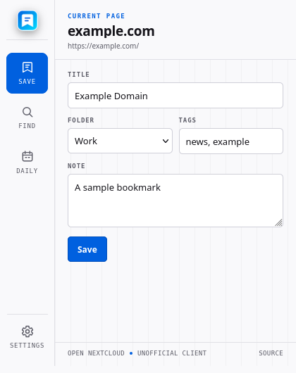
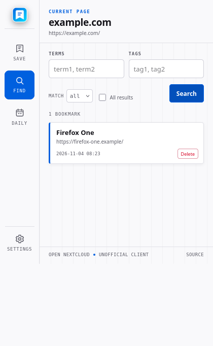
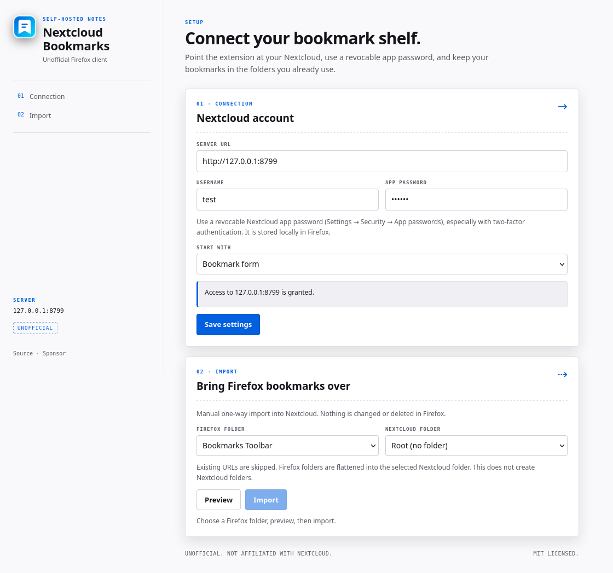

# Nextcloud Bookmarks

[](https://github.com/tmiland/nextcloud-bookmarks)
[](LICENSE)
[](https://www.mozilla.org/firefox/)
[](https://extensionworkshop.com/documentation/develop/manifest-v3-migration-guide/)
[](https://github.com/sponsors/tmiland)

An unofficial Firefox client for the [Nextcloud Bookmarks](https://github.com/nextcloud/bookmarks)
app: save the current page, search and organize your bookmarks, and import
Firefox bookmarks manually.

> **Unofficial. Not affiliated with Nextcloud.** Nextcloud and Nextcloud
> Bookmarks are separate open-source projects. This extension is an independent
> client for the public Bookmarks REST API.

**Status:** v0.1.1 · Firefox MV3 · AMO submission not yet made.

## Screenshots

| Bookmark popup | Search results |
| --- | --- |
|  |  |

<p align="center">
  
  <br>
  <sub>Settings and the manual Firefox → Nextcloud import.</sub>
</p>

## Features

- Save the current page with a title, note, tags, and an existing Nextcloud
  folder.
- **Current-page detection**: if the page is already saved, load the stored
  title, note, tags, and folder, and offer **Update** or **Delete** instead of
  creating a duplicate.
- **Folder selector** populated from your existing own Nextcloud folders. The
  last used folder is remembered; single-folder bookmarks can be moved from the
  popup, while multi-folder bookmarks are shown read-only.
- **Tag autocomplete** from the tags already present in Nextcloud.
- Search by text, by one or more tags, with AND/OR matching, or with paging
  disabled.
- **Daily** tab for bookmarks tagged `daily` (lowercase; tag filters are exact).
- Delete bookmarks from the form or from search results with an inline
  confirmation.
- **Manual one-way import** of Firefox bookmarks into an existing Nextcloud
  folder, with a preview, duplicate-URL skipping, progress, and cancel. Nothing
  is changed or deleted in Firefox.
- Nextcloud **app password** support, including two-factor authentication.
- Optional per-server host access: the extension requests access only to the
  Nextcloud origin you configure.
- Follows the active Firefox light/dark theme using Firefox’s design colors.

It does **not** run automatic or two-way synchronization.

## Install

### Temporary (development)

1. Open Firefox → `about:debugging#/runtime/this-firefox`.
2. Click **Load Temporary Add-on…**.
3. Select `extension/manifest.json` from this repository.
4. Open the toolbar icon → **Settings**.
5. Enter your Nextcloud base URL, username, and app password, then **Save**.
6. Allow access to your Nextcloud server when Firefox asks.

### AMO

The add-on has not been submitted to AMO yet. AMO-listed builds update through
AMO automatically; the manifest intentionally has **no `update_url`**.

## Setup

1. Install the **Bookmarks** app in your Nextcloud instance.
2. In Nextcloud, open **Settings → Security → App passwords** and create a
   dedicated password for this extension. Do not use your main account
   password, especially if two-factor authentication is enabled.
3. In the extension settings, enter:
   - **Server URL** — the Nextcloud base URL, for example
     `https://cloud.example.com` or `https://cloud.example.com/nextcloud`.
     Remote servers must use HTTPS; `http://localhost` and `http://127.0.0.1`
     are allowed for local testing.
   - **Username** — your Nextcloud username.
   - **App password** — the password created in step 2.
4. Click **Save settings** and allow access to the configured server.
5. Open the toolbar icon. The current page’s URL and title are filled in
   automatically.

## Permissions and privacy

- `storage` — stores the server URL, username, app password, and UI preference
  locally in Firefox.
- `activeTab` — reads the current tab’s URL and title after you open the popup,
  so the bookmark form can be prefilled and checked against your saved
  bookmarks.
- Optional host access — requested only for the Nextcloud origin you configure.
- Optional `bookmarks` — requested only when you open the Firefox import
  section; it reads the Firefox bookmark tree for preview/import.

The extension sends data only to the Nextcloud server you configure:

- authentication information with every API request;
- the current page URL/title and the bookmark title, note, tags, and folder you
  enter;
- search terms and tags;
- the Firefox bookmarks you explicitly preview/import (URL and title), only
  after you grant the optional `bookmarks` permission.

There is no telemetry, analytics, remote logging, or third-party service. The app
password is stored locally in Firefox’s extension storage; use a revocable app
password. See [privacy_policy.md](privacy_policy.md).

## How it works

The extension uses the Nextcloud Bookmarks **REST API v2**:

```text
GET    /index.php/apps/bookmarks/public/rest/v2/bookmark?url={url}
GET    /index.php/apps/bookmarks/public/rest/v2/bookmark
POST   /index.php/apps/bookmarks/public/rest/v2/bookmark
PUT    /index.php/apps/bookmarks/public/rest/v2/bookmark/{id}
DELETE /index.php/apps/bookmarks/public/rest/v2/bookmark/{id}
GET    /index.php/apps/bookmarks/public/rest/v2/folder
GET    /index.php/apps/bookmarks/public/rest/v2/tag
```

Requests use HTTP Basic auth. Create and update requests send tags as top-level
`tags[]` and folders as `folders[]`. The Firefox import is a manual, one-way
POST loop; it does not run in the background and never deletes or edits Firefox
bookmarks.

## Development

```sh
# Unit tests for URL, auth, request-building, and folder helpers
npm test

# Load the extension in Firefox
web-ext run --source-dir extension

# Package for AMO
npm run build
```

The build packages only the `extension/` directory via `web-ext-config.js`.

Main files:

- `extension/src/popup.mjs` — popup UI, current-page lookup, save/update/delete,
  search, folder/tag UI.
- `extension/src/options.mjs` — settings, permissions, and the manual Firefox
  import.
- `extension/src/api.mjs` — Nextcloud REST client.
- `extension/src/utils.mjs` — URL, auth, folder-tree, tag, and error helpers.
- `extension/manifest.json` — Firefox MV3 manifest.

## Limitations

- Firefox only.
- No automatic or two-way synchronization. The Firefox import is manual and
  one-way (Firefox → Nextcloud).
- The import flattens the selected Firefox folder tree into one existing
  Nextcloud folder; it does not create Nextcloud folders. Firefox bookmarks have
  no tags or notes, so those fields are empty after import.
- The folder picker lists your own Nextcloud folders; shared folders owned by
  other users are not offered. Existing bookmarks in multiple folders are shown
  read-only; move them in Nextcloud.
- Remote Nextcloud servers must use HTTPS. A self-signed certificate must be
  trusted by Firefox.
- Large imports run sequentially and can take a while; use the progress bar and
  Cancel button in Settings.

## Troubleshooting

- **“Authentication failed”** — use a Nextcloud app password, not your main
  password. Check the username and server URL.
- **“Access to your Nextcloud server is required”** — open **Settings** and
  grant server access for the configured origin.
- **“Bookmarks API not found”** — install/enable the Nextcloud Bookmarks app and
  check that the server URL is the Nextcloud base URL.
- **Tags are missing** — this client sends the top-level `tags[]` parameter
  required by Bookmarks 3.x.
- **Daily is empty after saving** — Daily is tag-based. Add the exact tag
  `daily` to the bookmark (lowercase; `Daily` is a different tag).
- **Import says “0 new”** — every URL in the selected Firefox folder already
  exists in Nextcloud, or the folder is empty. Duplicates are skipped by URL.
- **“Allow bookmarks access”** — the import needs the optional Firefox
  `bookmarks` permission. It is requested only when you click that button.

## Contributing

Issues and pull requests are welcome. Please keep changes focused, run
`npm test`, and describe the Firefox and Nextcloud Bookmarks versions you
tested.

## Support

If this extension saves you time, you can support development via
[GitHub Sponsors](https://github.com/sponsors/tmiland).

Bug reports and feature requests:
[GitHub Issues](https://github.com/tmiland/nextcloud-bookmarks/issues).

## AI assistance

This release was built with **DeepSeek V4.1 Flash** in OpenCode, with direction,
testing, and review from the maintainer. Review the source before deploying it.

## License

MIT — see [LICENSE](LICENSE). This is an unofficial project, not affiliated with
Nextcloud.
